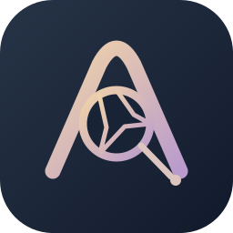
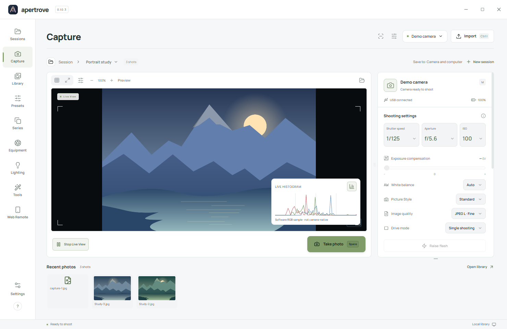
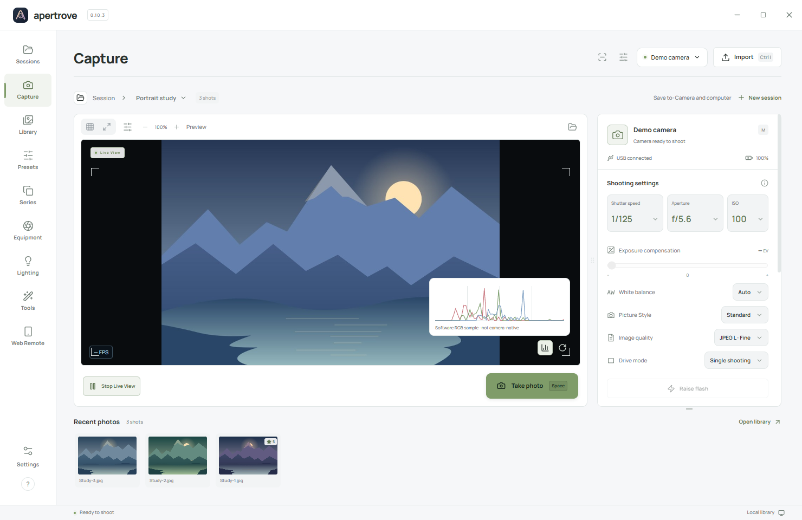
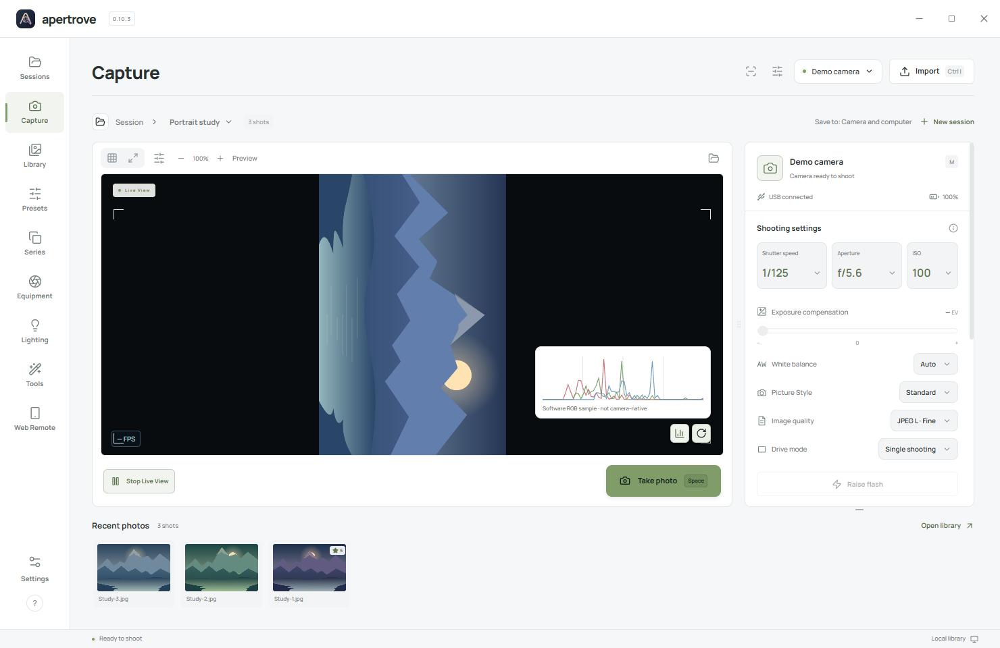
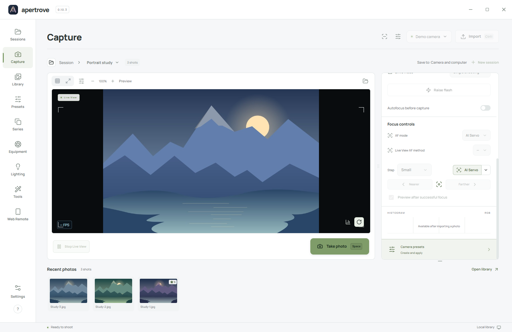
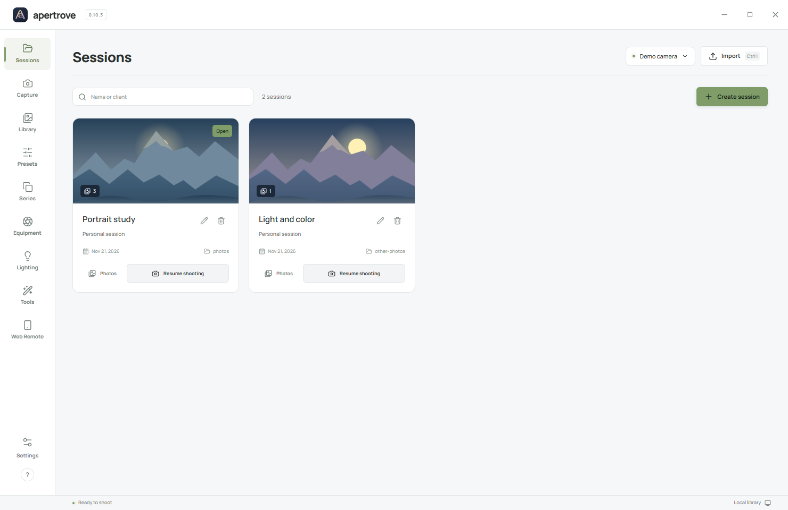
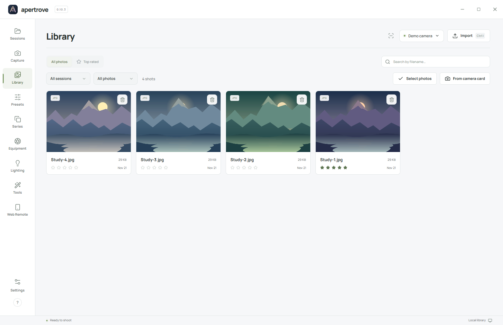
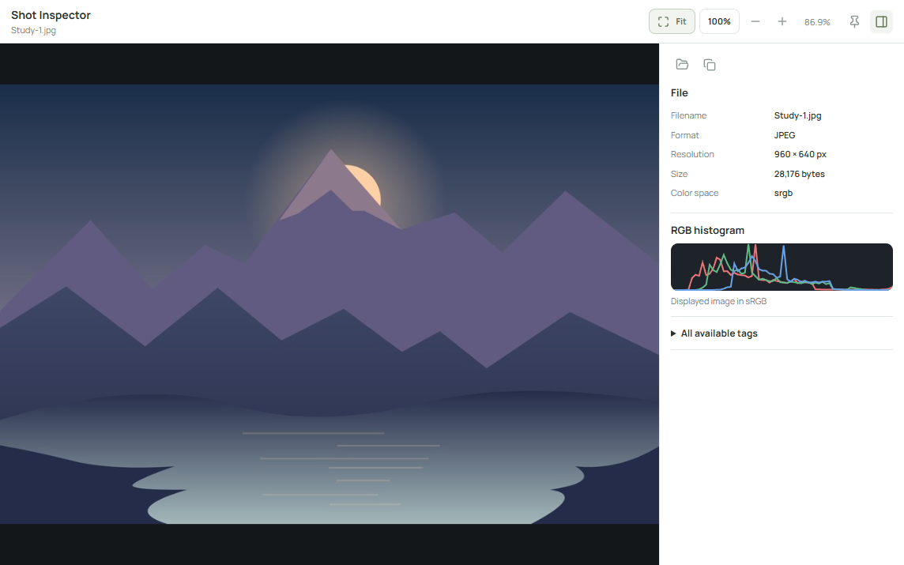
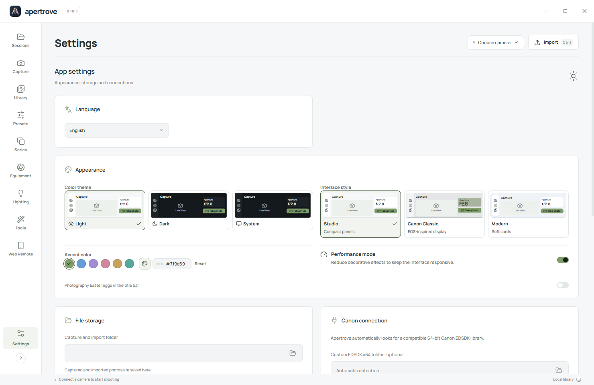
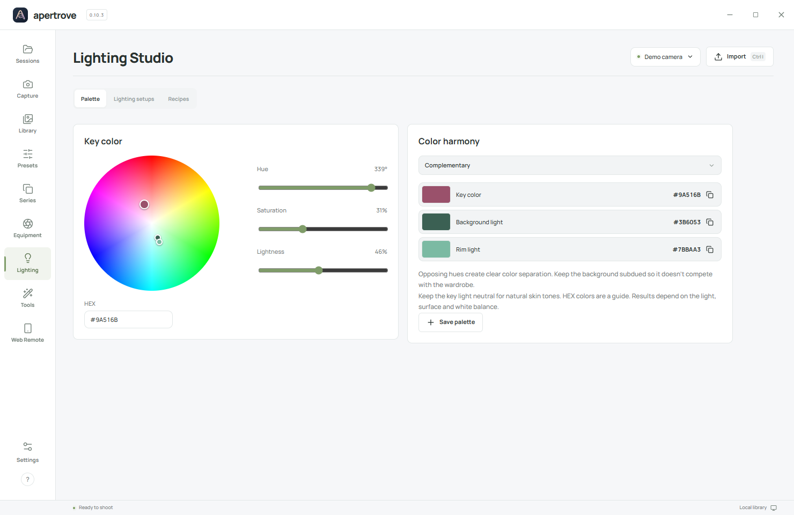

<p align="center"></p>
<h1 align="center">Apertrove</h1>
<p align="center"><strong>Compose on the big screen. Keep the whole shoot together.</strong></p>
<p align="center">An independent camera and photo workspace for Canon EOS on Windows.</p>

<p align="center">
  <a href="https://github.com/M1denHvH/Apertrove/actions/workflows/ci.yml"></a>
  <a href="https://github.com/M1denHvH/Apertrove/releases/tag/Release"></a>
  <a href="package.json"></a>
  <a href="docs/REQUIREMENTS.md"></a>
  <a href="LICENSE"></a>
</p>

<p align="center"><a href="https://github.com/M1denHvH/Apertrove/releases/tag/Release">Download</a> · <a href="docs/INSTALLATION.md">Start here</a> · <a href="docs/USER_GUIDE.md">User guide</a> · <a href="docs/COMPATIBILITY.md">Camera support</a> · <a href="README.ru.md">Русский</a></p>



Apertrove gives a shoot a home: camera settings beside the preview, a folder for the session, and a library for reviewing what arrives. It is useful at a product table, in a small studio, or whenever you want to frame and review photographs on a larger screen.

Connect a compatible Canon EOS camera by USB, or start with photographs already on your computer. Sessions, the local Library and Lighting Studio work without a camera.

**About this version:** the published Windows release is **0.10.3, dated 14 November 2026**. This source branch includes later changes while retaining that version number. The screenshots and guides describe the current source; they do not mean those changes are already in the published download.

[Explore](#a-workspace-for-the-shoot) · [Screenshots](#see-it-in-use) · [Install](#your-first-session) · [Compatibility](#bring-your-canon-eos) · [Help test](#help-us-test-more-cameras) · [Develop](#build-and-contribute)

## A workspace for the shoot

**Frame before you shoot.** Live View brings the preview to your monitor with zoom, composition guides and a small RGB histogram toggle. Rotate the preview by hand, or use current orientation data when the camera and runtime supply it.

**Keep focus close at hand.** One AF control contains One Shot AF and an AI Servo switch. Exposure, white balance, image quality and electronic lens steps follow the controls your camera actually offers. A running Servo command can stay active while you use the shutter.

**Give every shoot its own place.** Create a named session with a folder, client and notes. Resume it later, review its photographs together, and reuse camera presets. Preset sequences and interval tools are available for supported setups.

**Review without rewriting your originals.** Search and rate photographs in the Library, inspect metadata, save nondestructive adjustments and export separate JPEGs. Shot Inspector provides a second window for reviewing received camera frames. RAW viewing uses an embedded preview where available; edited RAW-to-JPEG export is not supported.

**Work away from the keyboard.** Web Remote opens a limited set of controls in a phone browser on your trusted local network. The camera remains connected to the PC by USB. Lighting Studio helps you explore color palettes and plan a lighting setup.

## See it in use

These are direct screenshots of the running Electron application, using a separate **demo profile, fake camera provider and sample artwork**. They show real application UI; they are not a physical-camera test. No interface images were generated with AI.

| Live View histogram | Portrait preview |
| --- | --- |
|  |  |

<details>
<summary><strong>Focus — One Shot and AI Servo in one control</strong></summary>



</details>

<details>
<summary><strong>Sessions — pick up where you left off</strong></summary>



</details>

<details>
<summary><strong>Library — review and select</strong></summary>



</details>

<details>
<summary><strong>Shot Inspector — a separate place to review a frame</strong></summary>



</details>

<details>
<summary><strong>Settings and Lighting Studio</strong></summary>





</details>

## Your first session

1. Get the Windows x64 ZIP and `SHA256SUMS.txt` from [Releases](https://github.com/M1denHvH/Apertrove/releases/tag/Release). Check the ZIP's SHA-256, then extract the whole archive.
2. Open **Apertrove.exe** inside the extracted folder. Keep its other files alongside it. The portable build is unsigned.
3. Choose a language and appearance. You can skip camera setup and import existing photographs straight away.
4. For camera work, install compatible official Canon x64 EDSDK components separately, close other camera applications, and follow Apertrove's setup guide.
5. Create a session, choose its folder and open **Capture**. Start Live View when your camera offers it.

[Installation and first connection](docs/INSTALLATION.md) · [Requirements](docs/REQUIREMENTS.md) · [Troubleshooting](docs/TROUBLESHOOTING.md)

## Bring your Canon EOS

Apertrove is intended for compatible Canon EOS cameras supported by the installed EDSDK runtime. Features depend on the body, firmware, lens, camera mode and runtime together. A greyed control means the current connection does not offer that action.

Windows x64 is the current target. Canon DLLs and proprietary headers are **not included**; obtain the appropriate components from Canon. Web Remote is a connection to Apertrove on your computer, not direct camera Wi-Fi support.

The project is still gathering camera testing reports. Earlier hardware checks cover a limited set of camera reads, exposure controls and Live View. Newer Servo, orientation and capture workflows also have automated fake-provider coverage, which cannot prove optical focus, physical shutter behavior or compatibility with every camera.

Development builds include built-in flash pop-up and BULB controls for verified camera/runtime combinations. Availability varies, and physical compatibility still needs hardware testing. Other connections keep those controls unavailable. See [camera support and limits](docs/COMPATIBILITY.md) before planning a shoot around them.

## Help us test more cameras

Have a compatible EOS camera? We would welcome your experience. You do not need to be a developer: tell us what you tried, what you expected and what happened. Reports from different cameras help identify gaps that one setup cannot reveal.

[Open a camera or app bug report](https://github.com/M1denHvH/Apertrove/issues/new?template=bug_report.yml). For a camera issue, include the model, firmware, lens, camera mode, Apertrove version and Canon runtime version if you can find it. Screenshots and short logs can help; remove private paths, serial numbers, personal images and remote access links first. **Do not upload Canon SDK files.**

Ideas are welcome through [feature requests](https://github.com/M1denHvH/Apertrove/issues/new?template=feature_request.yml). Security issues have a [separate reporting guide](SECURITY.md).

## Build and contribute

Use Windows x64, Git, **Node.js 24** and npm. The UI, local library and synthetic tests can be developed without Canon software.

```powershell
git clone https://github.com/M1denHvH/Apertrove.git
cd Apertrove
npm ci
npm test
npm run build
npm start
```

For renderer development, use `npm run dev` with the separate Electron launch described in [Development](docs/DEVELOPMENT.md). `npm run package` creates a local portable folder; it publishes nothing.

[Contributing](CONTRIBUTING.md) · [Development and tests](docs/DEVELOPMENT.md) · [Architecture](docs/ARCHITECTURE.md) · [Translation](docs/localization.md)

## License

Apertrove's source is [MIT licensed](LICENSE). Canon software and other dependencies have their own terms; see [third-party notices](THIRD_PARTY_NOTICES.md). This is an independent project, not affiliated with or endorsed by Canon.

[Documentation](docs/README.md) · [Privacy](docs/PRIVACY.md)
