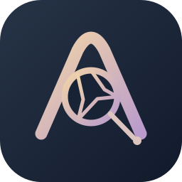
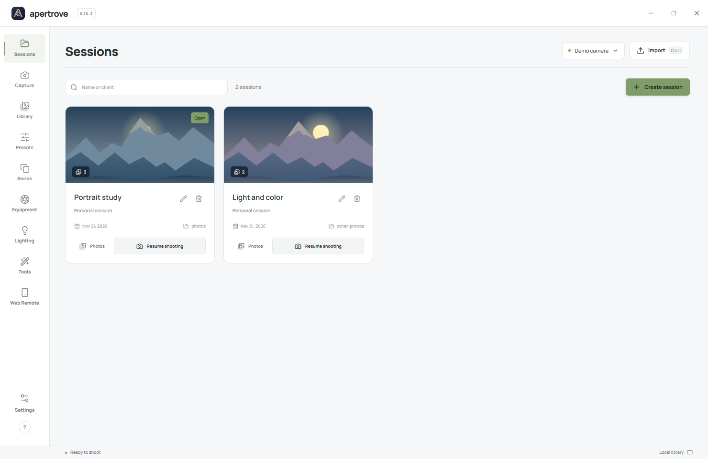
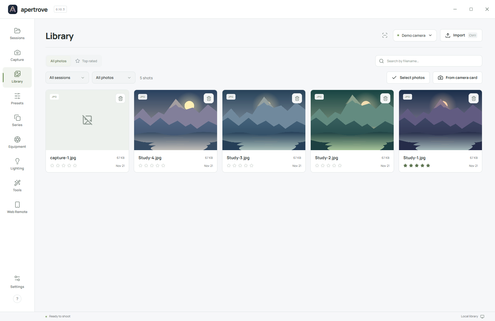
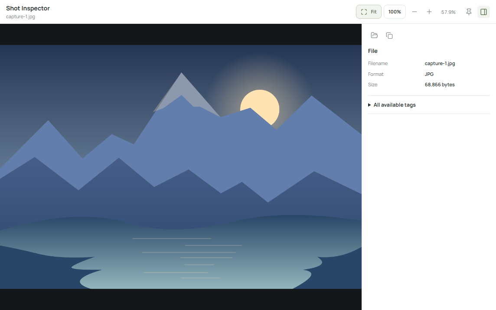
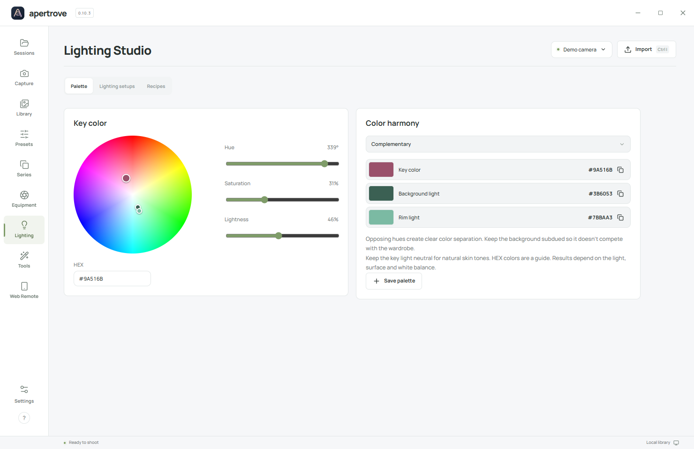
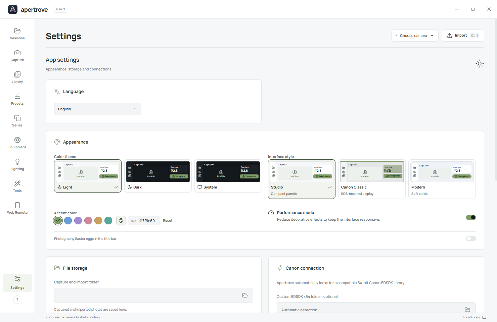

<p align="center"></p>
<h1 align="center">Apertrove</h1>
<p align="center"><strong>Камера, съёмка и следующий кадр — в одном рабочем пространстве.</strong></p>
<p align="center">Управление Canon EOS, Live View и библиотека фотографий для Windows.</p>

<p align="center">
  <a href="https://github.com/M1denHvH/Apertrove/actions/workflows/ci.yml"></a>
  <a href="package.json"></a>
  <a href="LICENSE"></a>
  <a href="https://github.com/M1denHvH/Apertrove/releases/latest"></a>
</p>

<p align="center"><a href="https://github.com/M1denHvH/Apertrove/releases">Скачать</a> · <a href="docs/INSTALLATION.md">Установка</a> · <a href="docs/STUDIO.ru.md">Руководство</a> · <a href="docs/COMPATIBILITY.md">Совместимость</a> · <a href="README.md">English</a></p>


Apertrove объединяет параметры камеры, кадрирование, просмотр фотографий и папки фотосессий. Подключите совместимую Canon по USB, чтобы строить кадр на большом экране. Для работы с уже снятыми фотографиями камера не нужна.

Это независимый open-source проект. Программа использует отдельно установленный Canon runtime; библиотеки и проприетарные заголовки Canon в комплект не входят.

## Для работы на съёмке

| Камера и кадр | Фотографии и организация |
| --- | --- |
| Live View с масштабом, направляющими и компактным переключателем RGB-гистограммы | Отдельная папка, заметки и пресеты для каждой фотосессии |
| Экспозиция, баланс белого, формат и фокус по возможностям камеры | Импорт готовых файлов, оценки, фильтры и метаданные |
| Одноразовый AF, удерживаемая команда AI Servo и электронная доводка объектива | Неразрушающие правки, отдельный экспорт JPEG и JSON |
| Пресеты, очередь пресетов и интервальная съёмка | Отдельное окно Shot Inspector для зарегистрированных кадров с камеры |
| Веб-пульт для телефона в доверенной локальной сети | Палитры и схемы света в Lighting Studio |

Возможности зависят от камеры, объектива, режима и runtime. Принятие команды AI Servo не означает подтверждённый оптический фокус. Управление BULB и механическим подъёмом вспышки остаётся недоступным до подтверждения соответствующих протоколов. Съёмка и передача файлов требуют дальнейшей проверки на оборудовании. [Подробнее о совместимости](docs/COMPATIBILITY.md).

## Галерея

Все изображения сняты непосредственно из работающей программы. Использован отдельный демонстрационный профиль, sample-изображения и fake provider. Это **симуляция**, а не подтверждение работы физической камеры.

<details open>
<summary><strong>Фотосессии — контекст и папка каждой съёмки</strong></summary>



</details>

<details>
<summary><strong>Библиотека — просмотр и отбор</strong></summary>



</details>

<details>
<summary><strong>Shot Inspector — просмотр в отдельном окне</strong></summary>



</details>

<details>
<summary><strong>Lighting Studio — палитра и свет</strong></summary>



</details>

<details>
<summary><strong>Настройки рабочего пространства</strong></summary>



</details>

## Первый запуск

1. Скачайте Windows x64 ZIP и файл контрольных сумм из [Releases](https://github.com/M1denHvH/Apertrove/releases). Сверьте SHA-256 и распакуйте архив целиком.
2. Откройте **Apertrove.exe**. Остальные файлы должны оставаться рядом. Портативная сборка не подписана.
3. Для работы с камерой отдельно установите совместимые официальные компоненты **Canon EDSDK x64**. Мастер настройки поможет выбрать runtime и проверить возможности камеры.
4. Создайте фотосессию и выберите её папку. Откройте **Съёмка → Включить Live View**, либо пропустите настройку камеры и импортируйте готовые снимки в Библиотеку.

Опубликованный выпуск — отдельный снимок версии. В этой рабочей ветке есть дальнейшие изменения; номер исходников остаётся **0.10.3** до подготовки нового релиза.

[Установка](docs/INSTALLATION.md) · [Требования](docs/REQUIREMENTS.md) · [Решение проблем](docs/TROUBLESHOOTING.md)

## Требования

Windows x64; для сборки из исходников — Git, Node.js 24 и npm. Для камеры нужны USB-кабель с передачей данных, совместимая камера и отдельно установленный Canon runtime. Для веб-пульта компьютер и телефон должны находиться в одной доверенной сети.

Библиотека и Lighting Studio работают без Canon SDK. При проверке передачи файлов храните независимую копию важных оригиналов.

## Разработка

```powershell
git clone https://github.com/M1denHvH/Apertrove.git
cd Apertrove
npm ci
npm run build
npm start
```

Интерфейс построен на React и Vite, desktop-сервисы — на Electron. Камера обслуживается отдельным worker через Koffi и EDSDK. Тесты с fake provider не требуют камеры.

[Разработка и проверки](docs/DEVELOPMENT.md) · [Архитектура](docs/ARCHITECTURE.md) · [Участие в проекте](CONTRIBUTING.md) · [Локализация](docs/localization.md)

## Обратная связь

Сообщите о проблеме через [bug report](https://github.com/M1denHvH/Apertrove/issues/new?template=bug_report.yml), указав версию и шаги воспроизведения. Удалите ключи доступа, приватные пути, серийные номера и личные фотографии. Идеи можно предложить через [feature request](https://github.com/M1denHvH/Apertrove/issues/new?template=feature_request.yml).

Исходный код распространяется по [MIT](LICENSE). У Canon runtime и зависимостей собственные условия. Apertrove не является продуктом Canon и не связан с компанией.

[Сторонние лицензии](THIRD_PARTY_NOTICES.md) · [Конфиденциальность](docs/PRIVACY.md) · [Безопасность](SECURITY.md)
