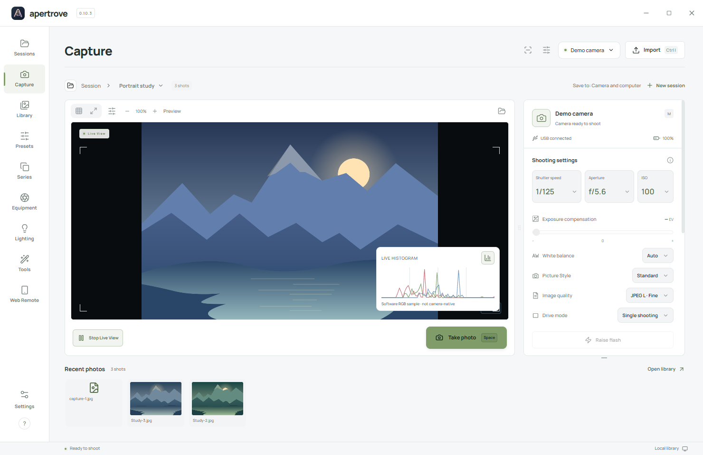

<h1 align="center">Apertrove</h1>

<strong>Стройте кадр на большом экране. Держите съёмку под рукой.</strong>

Независимое рабочее пространство для Canon EOS и фотографий на Windows.

  
  
  
  
  

<a href="https://github.com/M1denHvH/Apertrove/releases/tag/Latest">Скачать</a> · <a href="docs/INSTALLATION.md">Установка</a> · <a href="docs/STUDIO.ru.md">Руководство</a> · <a href="docs/COMPATIBILITY.md">Совместимость</a> · <a href="README.md">English</a>

Apertrove собирает съёмку в одном месте: настройки камеры рядом с изображением, отдельная папка фотосессии и библиотека для отбора полученных кадров. Это удобно за предметным столом, в небольшой студии и везде, где хочется строить кадр и оценивать фотографии на большом экране.

Подключите совместимую Canon EOS по USB или начните с готовых снимков. Фотосессии, локальная библиотека и Lighting Studio работают без камеры.

**О версии:** опубликованный Windows-выпуск и исходники в `main` — **0.10.4 от 24 ноября 2026 года**. В выпуск вошли исправления превью карточек камеры, восстановления состояния камеры и удержания управления, описанные в текущих руководствах.

[Возможности](#рабочее-пространство-для-съёмки) · [Галерея](#посмотрите-на-программу) · [Начало работы](#первая-фотосессия) · [Камеры](#подключите-свою-canon-eos) · [Помощь](#помощь)

## Рабочее пространство для съёмки

**Сначала постройте кадр.** Live View выводит изображение на монитор: масштаб, композиционные направляющие и небольшая иконка RGB-гистограммы помогают оценить его до съёмки. Превью можно повернуть вручную; при доступных данных ориентации камеры поворот выполняется автоматически.

**Фокус рядом.** Один AF-контрол объединяет One Shot и переключение AI Servo. Удерживайте Ближе/Дальше для электронных шагов фокуса и отпустите для остановки. Экспозиция, баланс белого и формат зависят от возможностей камеры и объектива. Работающий Servo может оставаться активным при спуске затвора.

**У каждой съёмки своё место.** Создайте сессию с папкой, клиентом и заметками. Вернитесь к ней позже, просмотрите её снимки и используйте сохранённые пресеты. Для поддерживаемых подключений есть очередь пресетов и интервальные инструменты.

**Отбирайте, сохраняя оригиналы.** Ищите фотографии, ставьте оценки, смотрите метаданные и сохраняйте неразрушающие правки. JPEG экспортируется в отдельный файл. Shot Inspector открывает полученный кадр с камеры в отдельном окне. Просмотр RAW зависит от встроенного JPEG; экспорт отредактированного RAW в JPEG не поддерживается.

**Отойдите от клавиатуры.** Веб-пульт даёт ограниченный набор действий в браузере телефона в доверенной локальной сети. Камера остаётся подключена к компьютеру по USB. В Lighting Studio можно подобрать палитру и спланировать свет.

## Посмотрите на программу

Это прямые скриншоты работающего Electron-приложения. Использованы отдельный **демонстрационный профиль, fake provider камеры и sample-изображения**. Интерфейс настоящий, но галерея не является аппаратной проверкой камеры. Изображения интерфейса не создавались генератором изображений.

| Гистограмма Live View | Вертикальное превью |
| --- | --- |
|  |  |

<strong>Фокус — One Shot и AI Servo в одном контроле</strong>

<strong>Фотосессии — вернитесь к своей съёмке</strong>

<strong>Библиотека — просмотр и отбор</strong>

<strong>Shot Inspector — кадр в отдельном окне</strong>

<strong>Настройки и Lighting Studio</strong>

## Первая фотосессия

1. Скачайте Windows x64 ZIP и `SHA256SUMS.txt` из [Releases](https://github.com/M1denHvH/Apertrove/releases/tag/Latest). Сверьте SHA-256 и распакуйте архив целиком.
2. Откройте **Apertrove.exe** из распакованной папки. Остальные файлы должны оставаться рядом. Портативная сборка не подписана.
3. Выберите язык и оформление. Настройку камеры можно пропустить и сразу импортировать готовые фотографии.
4. Для работы с камерой отдельно установите официальные совместимые компоненты Canon EDSDK x64, закройте другие программы управления камерой и следуйте мастеру настройки Apertrove.
5. Создайте сессию, выберите её папку и откройте **Съёмку**. Включите Live View, если камера его предоставляет.

[Установка и первое подключение](docs/INSTALLATION.md) · [Требования](docs/REQUIREMENTS.md) · [Решение проблем](docs/TROUBLESHOOTING.md)

## Подключите свою Canon EOS

Apertrove предназначен для совместимых Canon EOS, которые поддерживает установленный EDSDK runtime. Доступность действий зависит от корпуса, прошивки, объектива, режима и runtime вместе. Недоступный контрол означает, что текущее подключение не предлагает это действие.

Сейчас целевая платформа — Windows x64. Canon DLL и проприетарные заголовки **не входят в комплект**: получите подходящие компоненты у Canon. Веб-пульт подключается к Apertrove на компьютере и не заменяет прямое управление камерой по Wi-Fi.

Совместимость зависит от камеры, прошивки, объектива и установленного Canon runtime. Перед важной съёмкой проверьте подключение и сделайте пробный кадр. Ограничения описаны в разделе [совместимость камер](docs/COMPATIBILITY.md).

В выпуске 0.10.4 доступны подъём встроенной вспышки и управление BULB удержанием кнопки для поддерживаемых сочетаний камеры и runtime — на компьютере и в Веб-пульте. Доступность зависит от камеры и установленного Canon runtime. После команды подъёма проверьте положение вспышки; перед следующей операцией убедитесь, что экспозиция завершилась. Подробнее — в разделе [совместимость камер](docs/COMPATIBILITY.md).

## Помощь

Если возникла проблема с камерой или программой, [отправьте сообщение](https://github.com/M1denHvH/Apertrove/issues/new?template=bug_report.yml). Укажите модель камеры, прошивку, объектив, версию Apertrove и Canon runtime, если они известны. Удалите личные пути, серийные номера, фотографии и ссылки веб-пульта из снимков экрана и журналов. **Не прикладывайте файлы Canon SDK.** Для сообщений об уязвимостях используйте [отдельный порядок](SECURITY.md).

## Лицензия

Исходники Apertrove распространяются по [MIT](LICENSE). У Canon software и сторонних зависимостей свои условия: [third-party notices](THIRD_PARTY_NOTICES.md). Это независимый проект, не связанный с Canon и не одобренный компанией.

[Документация](docs/README.md) · [Конфиденциальность](docs/PRIVACY.md)
