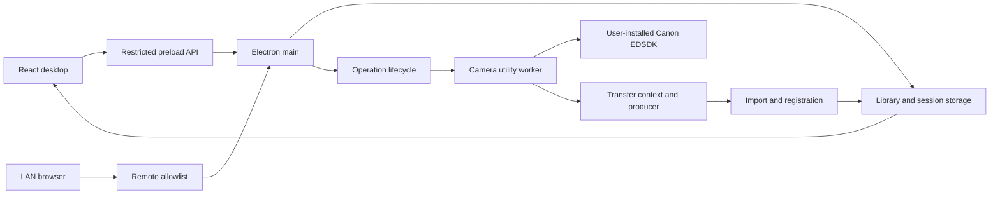

# How Apertrove fits together

Apertrove keeps the desktop interface, persistent library and native camera session in separate layers.

## Desktop and main process

The renderer in `src/` displays application state and submits commands through `electron/preload.cjs`. Main owns settings, sessions, file dialogs, library persistence, Web Remote and worker lifetime. Renderers have no direct SDK or filesystem access.

The main window and Shot Inspector use separate preload surfaces. The remote server has its own command allowlist; adding a desktop command must not automatically expose it to the LAN.

## Camera and operations

`electron/camera-worker.cjs` loads the local Canon runtime through Koffi and owns its references and callbacks. `operation-lifecycle.cjs` carries generation, operation and session-epoch identities across RPC. Native success, application completion and confirmed physical behavior are distinct outcomes.

Focus, Servo and exposure lifecycle helpers can be exercised with injected adapters. A command that leaves a physical action active needs an explicit stop route and shutdown cleanup. Unknown release or teardown state must remain visible.

## Files, sessions and previews

The transfer producer captures an immutable delivery context. The main-side consumer registers the original and its session association through the import pipeline. A renderer photo event follows successful library registration, rather than the earlier SDK transfer notification.

Canon object callbacks do not carry an application capture ID. Delivery routing and capture correlation are therefore distinct facts. Ambiguous provenance must be retained as ambiguity, without fabricating a confirmed capture or silently dropping a known session.

The library is a versioned JSON document. Registration and writes use the existing serialized commit and recovery paths; original photos are stored separately in session folders. Shot Inspector follows registered camera transfers; a Live View frame or focus preview is not a saved photograph.

## Verification boundaries

Unit and fake-provider tests exercise application behavior. Real Electron smoke tests additionally cover the actual main, preload, renderer and window lifecycle. Neither establishes new physical-camera support. Packaging, supported-runtime commands and hardware behavior each need their own evidence.

[Development workflow](DEVELOPMENT.md) · [Compatibility](COMPATIBILITY.md)
