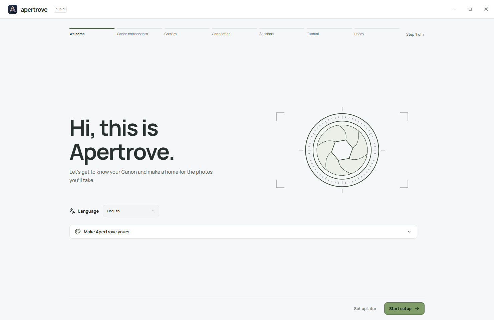

# Install Apertrove

## Download and open the portable app

1. Open the [0.10.3 release on GitHub](https://github.com/M1denHvH/Apertrove/releases/tag/Release). Download `Apertrove-0.10.3-Windows-x64.zip` and `SHA256SUMS.txt` from that release.
2. In PowerShell, go to your downloads folder and calculate the ZIP’s SHA-256. Compare it with the line for the same ZIP in `SHA256SUMS.txt`. Download the ZIP again if the values differ.

   ```powershell
   Get-FileHash -Algorithm SHA256 -LiteralPath '.\Apertrove-0.10.3-Windows-x64.zip'
   ```

3. Extract the whole ZIP to a folder you can write to. Open `Apertrove.exe` in the extracted application folder and keep its files and subfolders together. The portable app is unsigned, so Windows can show a reputation prompt. Follow your organization’s policy if Windows blocks it.

The download is a published snapshot. Build the source branch you want to evaluate by following [Development](DEVELOPMENT.md). See [system requirements](REQUIREMENTS.md) for the tested Windows and Canon combinations.

## Set up Apertrove without a camera

Choose your language and appearance on the welcome page. You can skip Canon setup and use **Sessions**, **Library**, and **Lighting Studio**. Choose a writable folder with room for your photos, then create a session and use **Import** to add existing files. You can reopen the setup wizard under **Settings** → **Setup and diagnostics** → **Setup guide**.



## Set up Canon EDSDK

Install official Canon software that supplies a compatible **x64 EDSDK** for your model and region, or obtain the SDK through Canon’s developer program. EOS Utility and Picture Style Editor may supply it depending on the release. Canon provides the runtime separately from Apertrove. Keep the official installation and its dependencies together. [Canon EOS Utility](https://www.usa.canon.com/support/eos-utilities) · [Canon SDK](https://www.usa.canon.com/support/sdk)

Apertrove looks in common Canon installation directories. In setup, use **Choose SDK folder** to point Apertrove to the folder containing `EDSDK.dll`, then select **Check again**. You can also set the path under **Settings** → **Canon connection** → **Custom EDSDK x64 folder · optional**. **Canon library loaded** confirms that Apertrove can load the selected runtime. Check the camera separately to see what it reports. [Troubleshooting](TROUBLESHOOTING.md)

## Check and connect the camera

1. Exit EOS Utility and any other app that could be using the camera. Turn the camera on, use its USB connection mode if applicable, and plug it directly into the PC with a USB data cable.
2. Open **Settings** → **Setup and diagnostics** → **Camera diagnostics**. Choose **Find cameras**, select the model, then select **Check capabilities**. This is a read-only camera check. For runtime problems, choose **Check SDK**.
3. Finish diagnostics before opening a working camera connection. To connect from the main app, open **Choose camera** in the header and choose your camera. For the preview, open a session and go to **Capture**.
4. The setup wizard’s shooting connection can also configure **Card and computer** or **Computer only**, subject to camera support. Camera capture and file handoff need further physical validation; keep independent originals while evaluating them. Use [local file import](USER_GUIDE.md#import-review-and-export) for existing photos and keep a separate copy of any important originals.

Back up your originals and local Apertrove profile before replacing a portable build. Older installations may use a Focal Studio profile. See [current camera support](COMPATIBILITY.md) and [how to recover from a setup or library error](TROUBLESHOOTING.md).
