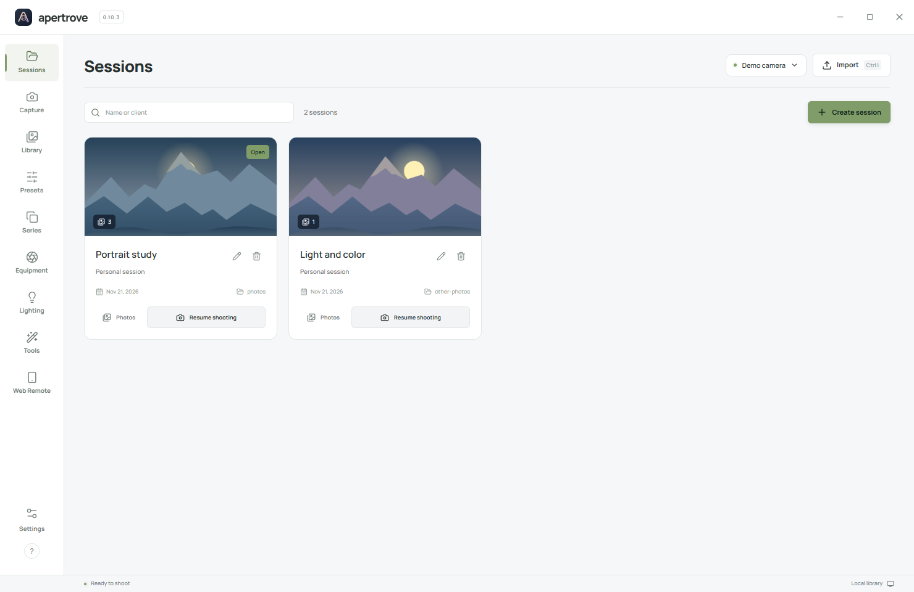
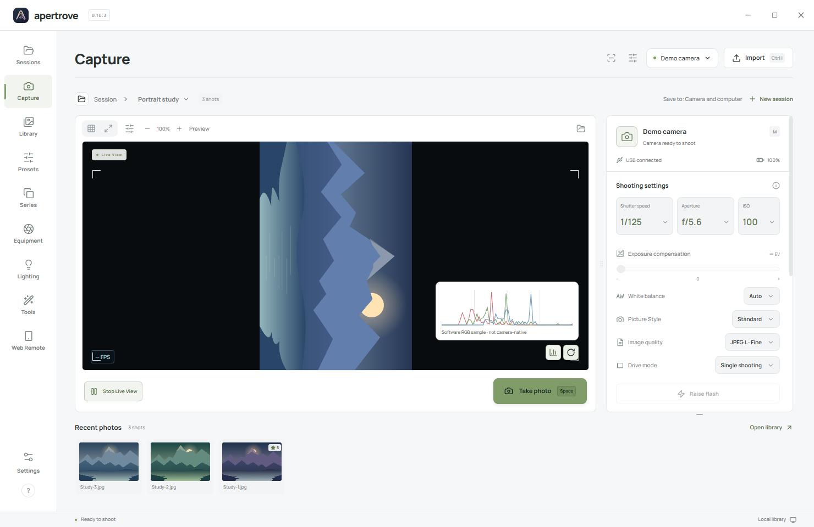
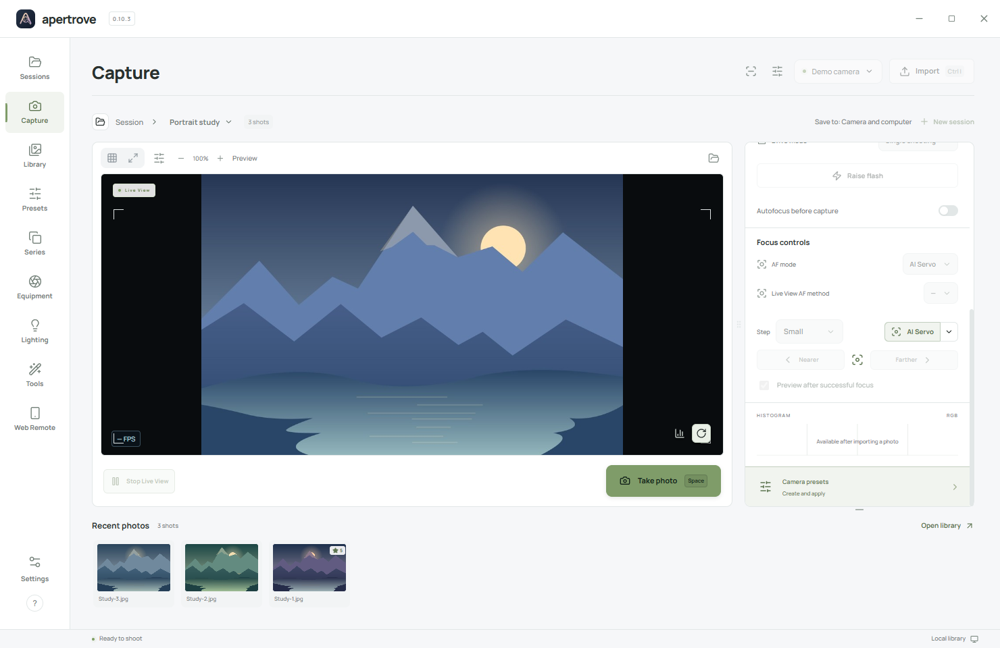
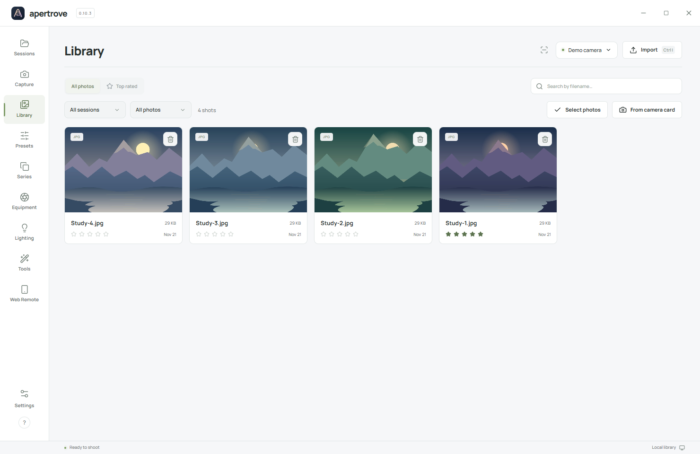
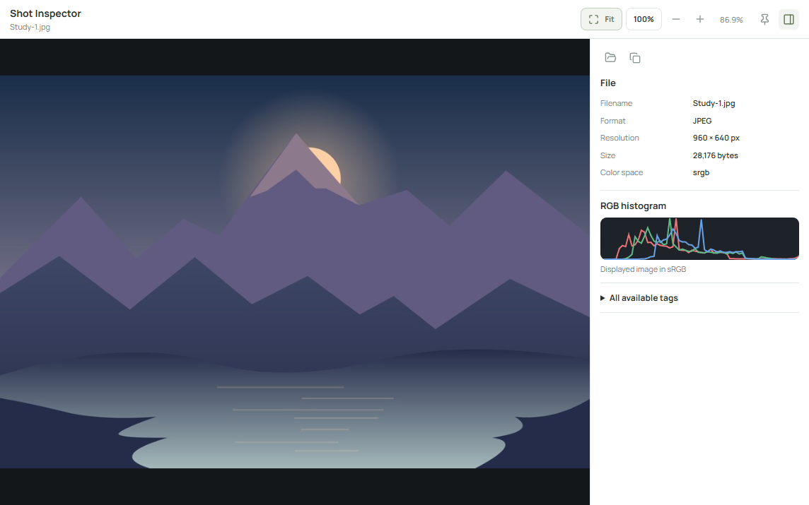

# Работа в Apertrove

[Установка](INSTALLATION.md) · [Совместимость](COMPATIBILITY.md) · [English guide](USER_GUIDE.md)

Обычная съёмка начинается в **Фотосессиях**, продолжается на экране **Съёмки** и заканчивается отбором в **Библиотеке**. Можно начать и с готовых фотографий без камеры. Руководство описывает текущие исходники; опубликованный архив 0.10.3 — более ранний снимок проекта.

Скриншоты сделаны из работающей программы с обозначенной demo-камерой и sample-изображениями. Они не подтверждают совместимость физической камеры.

## 1. Создайте фотосессию

В **Фотосессиях** выберите **Создать фотосессию**, задайте имя и доступную для записи папку с запасом места. Клиент, заметки и подпапка с датой помогают различать съёмки.

**Продолжить съёмку** открывает рабочий экран, **Снимки** — библиотеку этой сессии. Изменение папки действует на будущие файлы и не перемещает прежние оригиналы.

## 2. Подключите камеру и постройте кадр

Закройте EOS Utility и другие программы управления камерой. Включите камеру и подключите её кабелем USB с передачей данных. Выберите её в шапке приложения. [Мастер установки](INSTALLATION.md#connect-the-camera) объясняет проверку runtime и чтение возможностей камеры.

Рабочее подключение может настраивать назначение сохранения новых файлов. Проверьте его на экране Съёмки. При тестировании передачи сохраняйте отдельную копию на карте, если камера предлагает этот вариант.

Включите **Live View**. В панели над изображением доступны масштаб, сетка и **Композиционные направляющие**. Они помогают кадрировать, но не обрезают оригиналы. Через **Редактор панелей** можно менять состав и порядок рабочего пространства.

### Гистограмма

Маленькая иконка графика в углу превью открывает RGB-гистограмму. Повторное нажатие скрывает график — остаётся только иконка. Активное состояние показывает, что отображение включено. Есть tooltip, управление через Enter и Space.

Гистограмма рассчитывается по декодированному JPEG Live View. Это программная оценка превью, а не RAW-данные сенсора или гистограмма сохранённого кадра. Уже открытый график можно закрыть и при недоступном источнике данных.

### Ориентация

Если камера и runtime предоставляют актуальные данные положения корпуса, Apertrove поворачивает Live View автоматически. Иначе используйте маленькую иконку поворота по часовой стрелке: **0°, 90°, 180°, 270°**. Tooltip показывает угол и источник — вручную или от камеры.

Ручной поворот переопределяет автоматический. При доступном сенсоре рядом появляется кнопка возврата к ориентации камеры. Превью вписывается в доступное место, сохраняя пропорции и центр; масштаб увеличивает его равномерно. График и кнопки остаются горизонтальными.

Поворачивается только Live View. Фотографии, EXIF и настройки поворота самой камеры не изменяются. Ручной угол сбрасывается при закрытии этого превью.

## 3. Настройте экспозицию и фокус

В **Параметрах съёмки** выбирайте выдержку, диафрагму, ISO, баланс белого и формат из значений, которые предлагает камера. Доступность зависит от диска режимов, объектива и выполняемой операции. Недоступный контрол не нужно обходить принудительной командой.

### Один AF-контрол

- **AF** выполняет одну попытку One Shot.
- Стрелка внутри того же контрола открывает **One Shot AF** и переключатель **AI Servo**.
- При активном Servo основная кнопка подписана **AI Servo** и останавливает его. Меню также показывает активное состояние.

Переключение Servo не запускает One Shot. Работающий Servo может оставаться активным при одиночном спуске и continuous drive. Запрос кадра во время короткого переключения Servo ожидает завершения этой команды. Несовместимые действия временно недоступны; неизвестный результат отпускания требует внимания перед продолжением.

Принятая команда не доказывает резкость или слежение за объектом. Оцените превью и полученный кадр. Доступность зависит также от переключателя AF/MF на объективе и способа фокусировки камеры.

**Ближе** и **Дальше** выполняют электронные шаги фокуса там, где они поддерживаются. Выбирайте размер шага; нужен совместимый объектив и подходящее состояние камеры.

## 4. Снимите кадр или удерживайте серию

В одиночном режиме **Снять кадр** отправляет один запрос. Короткое нажатие включает отпускание затвора и не должно становиться намеренным удержанием на пять секунд.

В поддерживаемом серийном режиме удерживайте кнопку спуска для серии и отпустите для остановки. Space/Enter на фокусированной кнопке серии работают по тому же принципу. Уход из приложения или отмена ввода завершает удержание. Предельное время — запасная защита, а не длительность короткого клика. AI Servo должен сохранять этот смысл действий.

Дождитесь сохранения и проверьте полученный файл. Live View и AF-превью не являются сохранёнными фотографиями. Сообщение о неподтверждённом завершении означает, что приложение не смогло доказать полный результат; проверьте камеру, карту и выходную папку перед повтором.

Механический подъём встроенной вспышки и dedicated BULB пока недоступны. Настройка режима, световой импульс и физический подъём — разные операции. Программа не считает смену настройки доказательством поднятой вспышки.

## 5. Отберите полученные снимки

Кадр с камеры объявляется полученным после записи оригинала и подтверждения записи в библиотеке. При включённом автовыборе Съёмка выбирает новый кадр своей текущей сессии.

Отложенную передачу иногда нельзя достоверно отнести к одной сессии. Файл сохраняется, а сообщение предлагает выбрать его фотосессию. Откройте снимок в **Библиотеке → Фотосессия**. Переназначение меняет организацию и не перемещает оригинал. Удалённая исходная сессия тоже может требовать такого разбора.

### Импорт, просмотр и экспорт

Откройте сессию и используйте **Импорт** или **Ctrl+I**, чтобы скопировать готовые файлы. Ищите по имени, фильтруйте сессию или лучшие кадры. Откройте фотографию для просмотра метаданных и правок.

| Действие | Как выполнить |
| --- | --- |
| Поставить оценку | **1–5**; **0** сбрасывает |
| Скорректировать изображение | Экспозиция, контраст, насыщенность, теплота, монохром и поворот в просмотрщике |
| Сохранить правки | **Сохранить изменения** записывает инструкции без изменения оригинала |
| Получить отдельное изображение | **Экспорт JPEG** |
| Сохранить метаданные | **Все метаданные → JSON** |

Просмотр RAW зависит от встроенного JPEG. Его детализация и гистограмма относятся к этому превью. Экспорт отредактированного RAW в JPEG недоступен.

Читайте подтверждение удаления: удаление записи библиотеки и отправка подходящих оригиналов в корзину Windows имеют разные последствия.

## 6. Откройте Shot Inspector

**Открыть Shot Inspector** в Съёмке или Библиотеке создаёт отдельное окно для второго монитора. Оно следует за зарегистрированными кадрами с камеры. Закрепите кадр, чтобы остановить обновление на время оценки деталей.

**Fit** показывает весь кадр, **100%** — детали; рядом находятся метаданные и RGB-гистограмма изображения. При 100% превью сопоставляется с физическими пикселями экрана. Локальный импорт доступен в основном просмотрщике библиотеки.

## 7. Повторяйте настройки и планируйте свет

В **Пресетах** сохраняйте параметры камеры и переносите их через JSON. Применяйте значения, доступные текущей камере. **Серия пресетов** выполняет очередь с повторами и пытается восстановить исходные параметры. В **Инструментах** находятся интервалы и журнал.

Для автоимпорта откройте сессию, выберите отдельную входящую папку и включите наблюдение. Входящая и выходная папки не должны содержать друг друга. Обрабатываются новые поддерживаемые файлы; прежние файлы и подпапки не сканируются.

**Lighting Studio** предлагает цветовые гармонии, палитры и схемы света. Это инструменты планирования: результат зависит от приборов, поверхностей и баланса белого. **Оборудование** показывает доступные сведения камеры и объектива и может загружать справочные материалы производителя. [Конфиденциальность](PRIVACY.md)

## 8. Используйте телефон и настройте интерфейс

В **Веб-пульте** выберите частный сетевой интерфейс компьютера и запустите сервер. Откройте QR-ссылку на телефоне в той же доверенной сети. Ссылка даёт доступ — храните её в тайне и остановите сервер после работы. Камера остаётся на USB; в браузере доступна только часть desktop-команд.

В **Настройках** выбирайте язык, светлую/тёмную/системную тему, Studio / Canon Classic / Modern, акцент и режим производительности. Здесь же находятся хранение файлов, Canon setup, мастер первого запуска и обучение.

[Решение проблем](TROUBLESHOOTING.md) · [Документация](README.md) · [Сообщить о проблеме](https://github.com/M1denHvH/Apertrove/issues/new?template=bug_report.yml)
