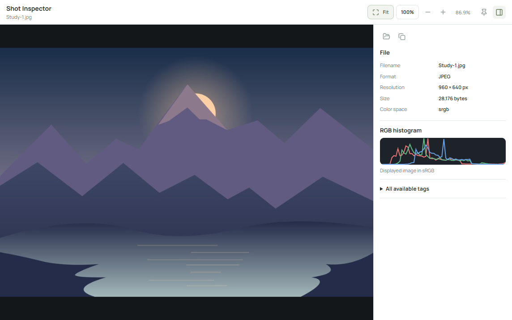

# Using Apertrove

[Install and connect](INSTALLATION.md) · [Camera support](COMPATIBILITY.md) · [Руководство на русском](STUDIO.ru.md)

A typical shoot starts in **Sessions**, moves to **Capture**, and finishes with review in **Library**. You can also import existing photographs without connecting a camera. This guide follows the current development source; the published 0.10.3 download is an earlier snapshot.

Screenshots show the real application with a labelled demo camera and sample artwork. They do not establish physical-camera compatibility.

## 1. Give the shoot a home

Open **Sessions → Create session**. Choose a name and a writable folder with enough space for the shoot. Add a client or notes if useful; a dated subfolder can keep separate shoots apart.

Use **Resume shooting** to open Capture, or **Photos** to open that session's Library. Changing a session folder affects future arrivals; it does not move existing originals.

## 2. Connect and frame

Close EOS Utility and other camera applications, turn the camera on, and connect it using a USB data cable. Choose your camera from the app header. The [installation guide](INSTALLATION.md#connect-the-camera) explains the setup wizard and read-only diagnostics.

A normal working connection can configure where new files are saved. Check the destination displayed on Capture. Keep a separate card copy when evaluating transfers if your camera offers that destination.

Start **Live View**. Use the preview toolbar to change zoom, enable the grid or open **Composition guides**. These are framing aids; they do not crop the original file. **Edit panels** lets you show, hide and reorder the workspace's panels.

### Histogram: a small icon, an optional graph

The chart icon in the preview corner opens the existing RGB graph. Press it again to hide the graph; only the small icon remains. The active state shows that display is enabled. The button supports Enter and Space and has a hover tooltip.

The histogram samples the current decoded Live View JPEG. It is a software preview histogram, not RAW sensor data or a histogram of a saved photograph. If data is unavailable, you can still close an already enabled graph.

### Orientation: camera data or manual rotation

When the camera and runtime supply current orientation data, Apertrove rotates Live View automatically. If they do not, use the small clockwise rotation icon. Each press advances through **0°, 90°, 180° and 270°**. Its tooltip tells you the angle and whether the source is manual or the camera.

A manual rotation overrides automatic orientation. When sensor data is available, the nearby return-to-camera-orientation button restores automatic behavior. The preview fits its available space while keeping its proportions. Zoom still enlarges it uniformly. The graph and controls stay upright.

Rotation affects Live View only. It does not rewrite photographs, EXIF or the camera's own rotation settings. Manual orientation resets when this preview is closed.

## 3. Set exposure and focus

Under **Shooting settings**, choose the shutter speed, aperture, ISO, white balance and image quality offered by the camera. The mode dial, lens and current operation determine which controls are writable. A disabled field is not an instruction to force the setting.

### One AF control

- Press **AF** for one One Shot autofocus attempt.
- Open the arrow inside the AF control to find **One Shot AF** and the **AI Servo** switch.
- With Servo active, the main button reads **AI Servo** and stops it when pressed. The menu also shows its active state.

Switching Servo does not perform a One Shot attempt. A running Servo command can remain active while you take a photograph or use continuous drive. A shutter request during a short Servo transition waits for that transition to finish. Incompatible actions remain unavailable while needed; an unknown release requires attention before further camera actions.

Command acceptance is different from confirmed sharpness or subject tracking. Inspect the preview and the received photograph. Lens AF/MF state and the camera's supported focus route affect availability.

**Nearer** and **Farther** send electronic lens steps where supported. Use the step size to control their amount; they require a compatible lens and camera state.

## 4. Take a photograph or hold for a series

In single drive, **Take photo** makes one shutter request. A short press includes a release; it should not become an intentional five-second hold.

In a supported continuous drive mode, hold the shutter button to shoot a series and release it to stop. Keyboard Space/Enter on the focused series button follows the same hold/release pattern. Leaving the application or cancelling the input ends the hold. The maximum hold limit is a fallback, not the intended length of a short click. Active AI Servo should preserve these input meanings.

Wait for the save operation and inspect the received file. Live View and an AF preview are not saved photographs. A message that capture completion is unverified means the app could not prove the complete result; check the camera, card and output folder before repeating it.

### Flash and BULB in development builds

These controls become available only for verified camera/runtime combinations. Their physical behavior still needs hardware testing; an unavailable control is the fallback for an unrecognized combination.

Use **Raise flash** when offered for a camera with a built-in flash. Check the camera after the request: an accepted command alone does not confirm the mechanism's position. Flash mode, firing and physical pop-up remain separate operations.

For a long exposure, set **BULB** on the camera, or choose Bulb in the shutter-speed control when offered. Press **Start BULB**, then **End BULB** to end the exposure. Other incompatible shooting actions stay unavailable while it is active. Elapsed time appears only when the camera reports it; a waiting message is not a local estimate.

If a stop fails or the connection is lost, the exposure may still be active. Check the camera and follow the displayed recovery instruction before starting another operation. Do not assume the shutter closed because the preview or app window changed.

## 5. Review what arrived

A received camera photo is announced after the original is written and its Library entry is committed. Capture automatically selects incoming photos belonging to its current session when that preference is enabled.

Sometimes a delayed transfer cannot be assigned to one session with confidence. The file is kept and a message asks you to choose its session. Open it in **Library → Photo session**. Reassignment updates organization; it does not move the original. A removed original session can also require review.

### Import, review and export

Open a session and use **Import** or **Ctrl+I** to copy existing photos into it. Search by filename, filter by session or use **Top rated**. Open a photo to view its metadata and adjustments.

| Action | How |
| --- | --- |
| Rate a photo | Keys **1–5**; **0** clears the rating |
| Compare or adjust | Exposure, contrast, saturation, warmth, monochrome and rotation in the viewer |
| Keep an adjustment | **Save edits** stores instructions without changing the original |
| Make a separate image | **Export JPEG** |
| Save metadata | **All metadata → JSON** |

RAW display depends on an embedded JPEG preview. Its displayed detail and histogram belong to that preview. Exporting an edited RAW to JPEG is unavailable.

Read deletion confirmations: removing a Library entry and moving eligible originals to the Windows Recycle Bin have different consequences.

## 6. Review in Shot Inspector

Choose **Open Shot Inspector** in Capture or Library for a separate window that can sit on another monitor. It follows registered camera arrivals. Pin a frame to stop it changing while you inspect detail.

Use **Fit** for the whole frame and **100%** for detail, with metadata and an image RGB histogram beside it. At 100%, the displayed preview maps to physical screen pixels. A local import remains accessible in the main Library viewer.

## 7. Reuse settings and plan the shoot

**Presets** save camera settings for reuse and support JSON import/export. Apply values the connected camera accepts. **Preset series** runs an ordered queue with repeat counts and attempts to restore the original settings. **Tools** contains interval controls and the activity log.

For folder-based import, open a session, choose a separate incoming folder and start **Auto import**. Incoming and output folders must not contain one another. It watches new supported files; existing files and subfolders are not scanned.

**Lighting Studio** offers color harmonies, saved palettes and lighting setups. Use them as planning aids; the result depends on actual lights, surfaces and white balance. **Equipment** displays available camera/lens information and may fetch manufacturer reference material. [Privacy](PRIVACY.md)

## 8. Use a phone and make the workspace yours

In **Web Remote**, choose the PC's private network interface and start the server. Open its QR link on a phone in the same trusted LAN. The link authorizes access: keep it private and stop the server when finished. The camera stays on USB; the remote provides a restricted subset of desktop controls.

In **Settings**, choose language, light/dark/system theme, Studio / Canon Classic / Modern style, accent color and Performance Mode. Storage, Canon setup, the welcome guide and interactive tutorial are here too.

[Need help?](TROUBLESHOOTING.md) · [All documentation](README.md) · [Tell us about a problem](https://github.com/M1denHvH/Apertrove/issues/new?template=bug_report.yml)
