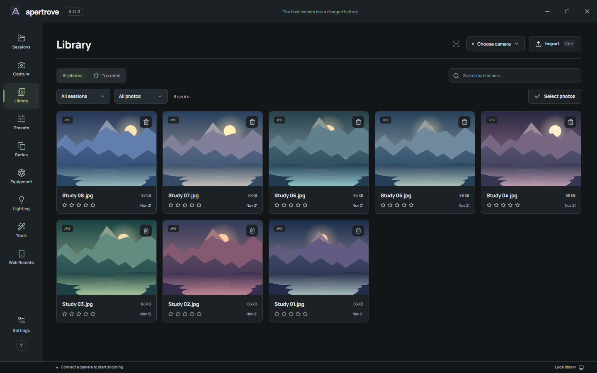
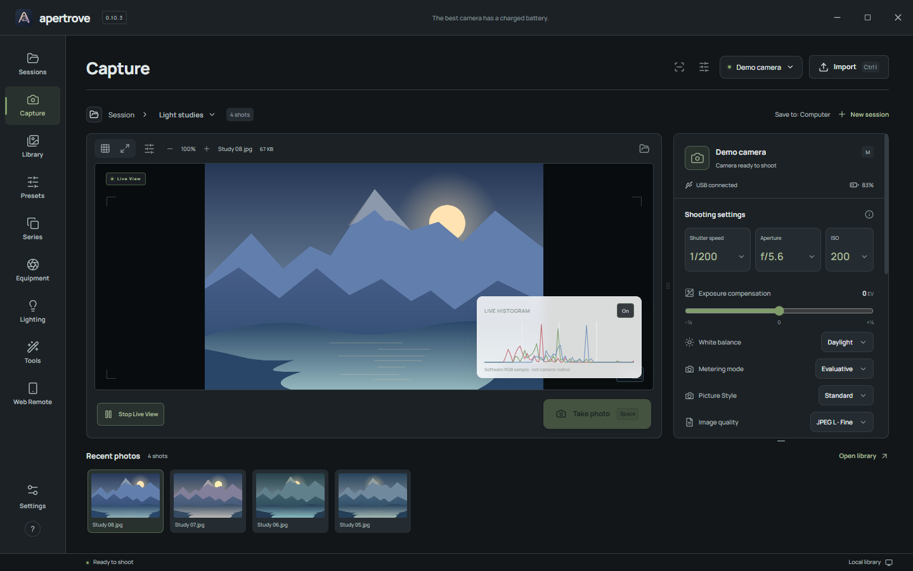
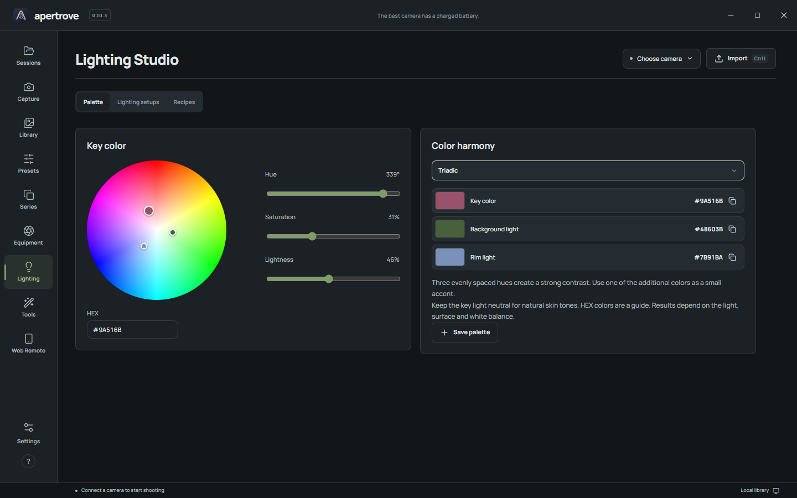

# Apertrove user guide

You can organize existing photos and plan lighting without connecting a camera. For USB setup, see [Install Apertrove](INSTALLATION.md#check-and-connect-the-camera).

The screenshots use an isolated demonstration profile and sample images. They illustrate the interface; camera hardware observations are listed in [requirements](REQUIREMENTS.md#camera-support).

## Sessions and Library

1. Open **Sessions** and choose **Create session**. Give the session a name and choose a writable folder. You can add a client name and notes, or ask Apertrove to create a dated subfolder.
2. Open the session and use **Import** in the header or press **Ctrl+I**. Select existing files to copy them into the session and add them to the library.
3. In **Library**, search by filename, change the session filter, or filter to **Top rated**. Open a photo to view its metadata and preview. Use **1–5** to rate an open photo and **0** to clear the rating.

The photo viewer includes exposure, contrast, saturation, warmth, monochrome and rotation controls. **Save edits** stores those adjustments in the library. Use **Export JPEG** for a separate raster export, or **All metadata** → **JSON** for metadata. RAW viewing depends on an embedded preview; JPEG export of edited CR2/CR3 files is disabled.

Read the confirmation before deleting a photo or session. The dialog distinguishes removing library entries from sending eligible originals to the Windows Recycle Bin. Keep a backup before removing originals or whole sessions.

## Preview and Live View

Open a session, go to **Capture**, then select **Start Live View** if the camera exposes it. When you finish framing, use **Stop Live View**. To change exposure, open **Shooting settings** and choose from the values offered by the camera. The mode dial determines which settings are writable. Try **M** when you need direct control of shutter speed and aperture.

The preview toolbar includes a grid, zoom and **Composition guides** for crop framing and safe areas. Guides are overlays and do not crop your original photos. Choose **Edit panels** in the header to show, hide or reorder the workspace panels. While Live View is active, switch **Live Histogram** on to see a software RGB sample calculated from the decoded preview. It describes the preview’s colors and brightness. When you review a saved photo, the **Histogram** panel describes that photo instead.

With a compatible AF lens and Live View active, **AF**, **Nearer** and **Farther** can send focus commands where supported. Check sharpness in the preview. Hardware tests on one EOS 2000D recorded command acceptance and left optical focus acquisition and physical lens movement unverified. [Camera support and limits](REQUIREMENTS.md#camera-support)

## Camera features and their status

**Camera diagnostics** is read-only. A working connection opened through **Choose camera** is intended for shooting and may configure the save destination. Separately, the controls-only route used for hardware validation supports specified exposure controls, Live View and supported focus commands with camera file operations disabled. The regular connection dialog has no controls-only selector.

**Capture**, **From camera card**, **Preset Series**, and interval shooting under **Tools** are implemented where the camera and connection support them. The EOS 2000D hardware checks covered exposure changes and restoration, Live View and its histogram. Shutter release, capture and camera file transfer have yet to pass hardware qualification. Keep an independent copy of your camera originals. [Camera support and limits](REQUIREMENTS.md#camera-support)

## Presets and tools

Go to **Presets** to save or edit settings for a setup. Use **Export JSON** and **Import JSON** to move presets between profiles. Applying one to a connected camera depends on which values the current camera mode accepts. **Preset Series** builds an ordered capture queue with repeat counts and attempts to restore the original settings after the run.

**Tools** also contains the activity log and **Watched folder**. To follow new files that another app saves, choose an incoming folder and select **Start auto import** while your target session is open. The incoming folder and session output must be separate and outside each other. Existing files and subfolders are not scanned. This workflow copies new supported files into the session and works independently of Canon EDSDK.

## Shot Inspector

Use **Open Shot Inspector** in the **Capture** or **Library** header to open the separate review window. It follows the latest registered camera transfer. Use the pin to hold a frame in place, switch between **Fit** and **100%**, or read metadata and the displayed image’s RGB histogram. For a local file you imported into a session, open it from **Library** to inspect it. A RAW file can be saved without a readable embedded preview.

## Lighting Studio and Equipment

Open **Lighting Studio** to choose a base color, compare harmonies, save palettes, and explore diagrams for placing lights. **Equipment** shows the camera and lens details that Apertrove can read. Manufacturer reference data and photos may come from an external source. [Privacy](PRIVACY.md)

## Web Remote

1. In **Web Remote**, select a private network interface on your PC and select **Start Web Remote**. The camera stays connected to the PC by USB.
2. Open the QR link from a phone on the same trusted network. Control availability follows the desktop session and camera capabilities.
3. Select **Stop remote** when finished. The link authorizes access while the server is running. Keep it private and avoid sending it over public Wi-Fi or exposing the server to the internet. [Privacy](PRIVACY.md) · [Security](../SECURITY.md)

## Settings

In **Settings**, change language, theme, design, accent color or Performance Mode. **File storage** contains the default capture and import path, the option to automatically select new photos, and the composition grid. Configure the Canon runtime under **Canon connection** or use **Setup and diagnostics** to reopen the setup wizard, check camera capabilities, or start the interactive tutorial.
